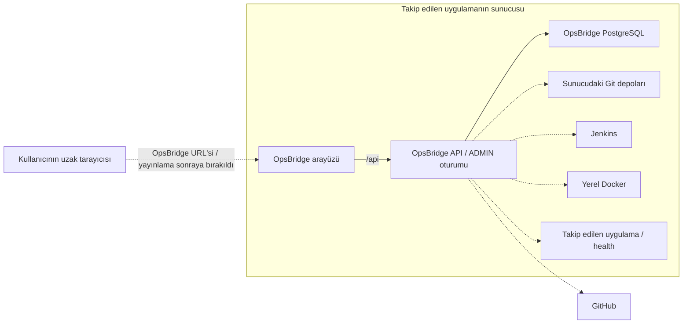

# OpsBridge çalışma ve erişim modeli

Karar tarihi: **2026-11-07 — Europe/Istanbul**.

## Kullanıcının belirlediği model

OpsBridge, takip edilen uygulamanın çalıştığı sunucuda ayrı bir uygulama olarak çalışır. Kullanıcı başka bir bilgisayardan tarayıcıyla OpsBridge'in URL'sine girer, admin hesabıyla oturum açar ve bu sunucudaki projeleri görüntüler/yönetir. Kullanıcının bilgisayarında ayrıca OpsBridge backend'i kurulması gerekmez.

Her OpsBridge kurulumu kendi sunucusundaki kaynakları esas alır. Bir merkezden farklı sunuculara SSH veya yardımcı servislerle bağlanan yönetim modeli bu kapsamda geliştirilmez. GitHub, sunucudaki projenin uzak Git kaynağı olarak kullanılabilir.

URL üzerinden yayınlama **en son ele alınacak ayrı iştir**. Alan adı, HTTPS ve dış erişim yapılandırması henüz uygulanmış değildir; kesin yayın tarihi belirlenmedi.

## Yerleşim ve veri akışı

Şema hedef yerleşimi gösterir. Kesikli bağlantılar henüz uygulanmamış entegrasyonlardır.

OpsBridge'in mevcut `frontend`, `backend`, `db` servisleri kendi Compose projesinde kalır. Takip edilen uygulamanın kodu, uygulama veritabanı ve dağıtımı ayrıdır. Aynı sunucuda bulunmak aynı container'da veya aynı Compose projesinde çalışmak anlamına gelmez.

| Sorumluluk | Çalışacağı yer |
|---|---|
| Ekranları kullanmak ve admin girişi yapmak | Kullanıcının tarayıcısı |
| Oturum/yetki kontrolü, Git/Jenkins/Docker işlemleri | Sunucudaki OpsBridge backend'i |
| OpsBridge profil ve ileride işlem kayıtları | OpsBridge'in kendi PostgreSQL'i |
| Yerel Git, Docker ve takip edilen uygulama | Aynı sunucunun kaynakları |

## Entegrasyonlara etkisi

- **Yerel Git:** Profildeki yerel depo yolu sunucuya aittir. Gönderilmemiş commit/branch yalnızca sunucudaki depoda varsa görülebilir. Tarayıcıyı açan kişinin bilgisayarındaki depo kendiliğinden okunmaz. GitHub okuma kapsamı devam eder.
- **Container erişimi:** OpsBridge backend'i container'da çalıştığı için host dosyaları ve Docker erişimi ayrıca bağlanmalıdır. Git görüntülemesi için salt okunur depo bağlantısı tasarım önerisi devam eder; gerçek mount ve Docker erişim yetkileri entegrasyon işinde hazırlanır.
- **Jenkins ve health:** İstekleri sunucudaki backend yapar. Container içindeki `localhost` backend container'ını gösterir; host veya diğer uygulama container'ı için erişilebilir adres ayrıca tanımlanır.
- **Yönetim işlemleri:** Admin oturumu backend'de doğrulanır. URL'den erişebilmek tek başına işlem yetkisi vermez. Build tetikleme gibi eylemler kendi geliştirme adımlarında eklenir; bu karar henüz bütün yönetim işlevlerinin uygulandığı anlamına gelmez.

## Mevcut durum ve sonraya bırakılan yayınlama

Kaynaklardaki Compose, OpsBridge servislerini aynı host'ta çalıştırır; host portları `127.0.0.1` ile sınırlıdır. Mevcut ADMIN session/CSRF ve profil CRUD akışı vardır. Gerçek Git/Jenkins/Docker/health bağlantıları henüz yoktur. Mevcut geliştirme makinesi bu sunucu modelinin yerel deneme ortamıdır.

Yayınlama aşamasında tek dış URL üzerinden arayüz ve `/api` erişimi, HTTPS ve buna uygun oturum cookie/proxy ayarları hazırlanır. Veritabanı ve Docker erişimi sunucu içinde kalır. Alan adı ve yayınlama aracı o aşamada seçilir. Kabul kanıtı, başka bir bilgisayardan URL'yi açıp admin girişi yapmak, yetkisiz yönetim isteklerinin reddedildiğini ve işlemlerin sunucudaki doğru kaynaklara ulaştığını doğrulamaktır.

Bu tasarım kararıyla portlar açılmadı, reverse proxy/TLS kurulmadı ve deployment yapılmadı. Güncel uygulama kanıtları [.wiki/STATUS.md](../.wiki/STATUS.md), geliştirme sırası [ROADMAP.md](ROADMAP.md), Git kapsamı [GIT_VISIBILITY.md](GIT_VISIBILITY.md) içindedir.
